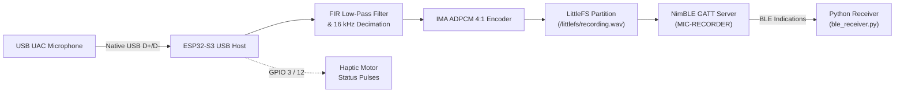

# ESP32-S3 USB Microphone Recorder & BLE Audio Streamer

[](https://www.espressif.com/en/products/socs/esp32-s3)
[](https://idf.espressif.com/)
[](https://platformio.org/)
[](https://mynewt.apache.org/)
[](LICENSE)

A standalone embedded audio recording system powered by an **ESP32-S3**. The firmware acts as a **USB Audio Class (UAC 1.0) Host**, capturing real-time PCM audio from any connected USB microphone, filtering and compressing the audio stream into **IMA ADPCM WAV**, saving it to onboard **LittleFS flash storage**, and wirelessly transferring the file to a PC using **Bluetooth Low Energy (BLE)** via acknowledged indications.

---

## Key Features

- **USB Host Audio (UAC 1.0)**: Interfaces directly with standard USB microphones and USB audio dongles via the ESP32-S3 native USB OTG peripheral.
- **Optimized Audio Processing Pipeline**:
  - 31-tap anti-aliasing **FIR low-pass filter** (cutoff ~6.8 kHz).
  - Software **decimation** to 16 kHz mono.
  - Digital gain staging (+8 dB default).
  - **IMA ADPCM (4:1) compression** (converts 16-bit PCM to 4 bits/sample), allowing up to 15 seconds of high-fidelity audio to fit seamlessly in internal RAM buffers before writing to flash.
- **Reliable Flash Storage (LittleFS)**: Stores captured recordings (`/littlefs/recording.wav`) in a dedicated 1.4 MB flash partition with wear leveling.
- **Robust BLE File Transfer (NimBLE)**:
  - Custom 128-bit GATT profile.
  - Transfer over **BLE Indications** (each packet is hardware-acknowledged by the client for lossless transmission).
  - Dedicated **Diagnostic / Log Channel** streaming firmware status checkpoints and heartbeats over BLE.
- **Physical Haptic Feedback**: Vibrator / motor pulse output on GPIO 3 & 12 signaling operational state (recording started, saved, transfer complete, errors).
- **Cross-Platform Python Client (`ble_receiver.py`)**: Asynchronous script powered by `bleak` that discovers the device, displays live firmware logs, downloads the WAV file with a progress bar, and saves it locally.

---

## System Architecture



---

## Hardware Requirements

| Component | Description |
|---|---|
| **MCU Board** | ESP32-S3 (e.g. ESP32-S3 Super Mini, DevKitC-1, FH4R2 with Quad PSRAM) |
| **Microphone** | Any standard USB Audio Class (UAC 1.0) microphone or USB soundcard dongle |
| **Power Supply** | 5V external power supply / breakout (USB microphones **require 5V VBUS** to enumerate) |
| **Haptic Motor** | Vibration motor or DC indicator driven via transistor / MOSFET on GPIO 3 & 12 |

### Wiring & Pinout

| ESP32-S3 Pin | Function | Connection |
|---|---|---|
| **GPIO 19** | `USB_D-` | USB Microphone Data Minus (D-) |
| **GPIO 20** | `USB_D+` | USB Microphone Data Plus (D+) |
| **5V / VBUS** | Power | USB Microphone 5V VBUS power rail |
| **GND** | Ground | Common Ground (ESP32-S3, USB Mic, Motor Driver) |
| **GPIO 3** | `MOTOR_IN1` | Motor Driver Control Pin 1 |
| **GPIO 12** | `MOTOR_IN2` | Motor Driver Control Pin 2 |

> [!IMPORTANT]
> The ESP32-S3 USB host peripheral operates at 3.3V logic on D+/D-, but almost all USB microphones **require 5.0V on their VBUS pin** to turn on and enumerate. Ensure 5V is supplied to the microphone VBUS.

---

## Motor Pulse Status Indicators

The vibration motor provides real-time haptic feedback on board status:

| Pulses | Meaning | Stage |
|:---:|---|---|
| **1 pulse** | Recording started | Audio streaming from USB mic |
| **2 pulses** | Recording saved | WAV header finalized & stored in LittleFS |
| **3 pulses** | BLE transfer started | PC client subscribed; sending audio chunks |
| **4 pulses** | BLE transfer completed | Full file received and verified by PC |
| **5 pulses** | USB / UAC init failed | USB host could not enumerate microphone |
| **6 pulses** | BLE init failed | NimBLE stack or NVS flash error |
| **7 pulses** | Recording failed | Audio timeout or flash write failure |

---

## BLE Protocol Specification

- **Device Name**: `MIC-RECORDER` (Legacy: `YAGEN_MIC`)
- **Primary Service UUID**: `00ffeedd-ccbb-aa99-8877-665544332211`

### GATT Characteristics

| Characteristic | UUID | Properties | Description |
|---|---|---|---|
| **Control** | `01ffeedd-ccbb-aa99-8877-665544332211` | Write | Write `0x01` to trigger upload; write `0x02` to trigger a new 5-second recording |
| **Data** | `02ffeedd-ccbb-aa99-8877-665544332211` | Indicate | First packet is 4-byte LE file size (`uint32_t`); subsequent packets are WAV chunks |
| **Log / Status** | `03ffeedd-ccbb-aa99-8877-665544332211` | Notify | ASCII diagnostic checkpoints (`BOOT_OK`, `MIC_DETECTED`, `RECORD_OK`, `XFER_COMPLETE status=OK`, `DIAG ...`) |

---

## Getting Started

### 1. Prerequisites

- [PlatformIO Core](https://platformio.org/) or [VS Code with PlatformIO Extension](https://marketplace.visualstudio.com/items?itemName=platformio.platformio-ide)
- Python 3.8+ (for PC receiver client)

### 2. Clone the Repository

```bash
git clone https://github.com/AjayKumar-AK/ESP32_with_USB_mic.git
cd ESP32_with_USB_mic
```

### 3. Build & Flash Firmware

Using PlatformIO CLI:

```bash
# Build the firmware
pio run

# Flash to connected ESP32-S3
pio run --target upload

# Open serial monitor (115200 baud)
pio run --target monitor
```

Or open the project in VS Code and use the PlatformIO toolbar:
- Click **Build** (`✓`)
- Click **Upload** (`→`)
- Click **Serial Monitor** (`🔌`)

---

## Receiving Audio on PC (Python)

### 1. Install Dependencies

```bash
pip install -r requirements.txt
```

### 2. Run the Receiver

```bash
python ble_receiver.py
```

### 3. Workflow

1. The script scans for `MIC-RECORDER`.
2. Once connected, it subscribes to the status log and data channels.
3. It requests the recording over BLE.
4. It streams the file with an interactive progress bar.
5. Saves the resulting file as `recording.wav` (and `rec_001.wav`).

### Advanced CLI Options

```bash
# Custom output file name
python ble_receiver.py --output my_test.wav

# Trigger a fresh 5-second recording over BLE before downloading
python ble_receiver.py --record-now

# Increase scan timeout
python ble_receiver.py --timeout 40
```

---

## Project Structure

```
├── .gitignore               # Git ignore rules for build files and audio outputs
├── CMakeLists.txt           # ESP-IDF top-level CMake configuration
├── README.md                # Project documentation
├── ble_receiver.py          # Python BLE client for downloading recordings
├── dependencies.lock        # Locked versions for ESP Component Manager
├── managed_components/      # ESP-IDF managed dependencies (USB Host, UAC, LittleFS)
├── partitions.csv           # Custom 4MB partition table (Factory app + LittleFS)
├── platformio.ini           # PlatformIO project configuration
├── requirements.txt         # Python dependencies (bleak)
├── sdkconfig.defaults       # Default ESP-IDF configuration (NimBLE, PSRAM, USB)
└── src/
    ├── CMakeLists.txt       # Source component CMake file
    ├── idf_component.yml    # Espressif component manager dependencies
    └── main.c               # Core firmware implementation
```

---

## Troubleshooting

- **Microphone not detected (`MIC_TIMEOUT` / 5 pulses)**:
  - Check that the microphone is receiving clean 5V power on its VBUS pin.
  - Verify USB D+ (GPIO 20) and D- (GPIO 19) are not swapped.
  - Some USB mics require a few seconds to enumerate; ensure `BOOT_DELAY_MS` is sufficient.
- **BLE device not found**:
  - Verify Bluetooth is enabled on your host PC.
  - Wait 10–15 seconds after ESP32 boot until the auto-recording completes and the board starts advertising.
  - On Windows, ensure BLE permissions are granted in Privacy settings.
- **Audio Playback**:
  - The output WAV file is encoded with standard IMA ADPCM (WAV format tag `0x11`) or PCM, which can be played directly with Windows Media Player, VLC, Audacity, or ffmpeg.

---

## License

This project is open-source and released under the [MIT License](LICENSE).
